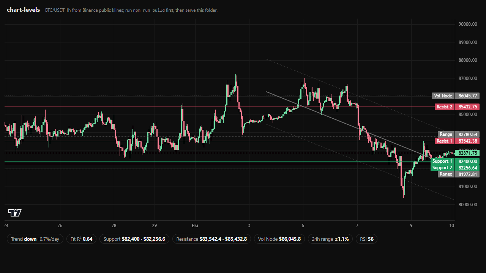

# chart-levels

**The analysis layer your chart is missing.** Feed it raw OHLCV candles, get back everything a professional terminal draws over price - as plain, auditable math with **zero dependencies**:

- **Support and resistance** from pivot clusters, weighted by touches, recency and the volume behind them
- **Regression trend channel** - several window lengths compete, the best R² wins; a poor fit is honestly called a *range*, never forced into a trend
- **Expected daily range** from EWMA volatility (the RiskMetrics convention), so it reacts to regime changes fast
- **Volume node (POC)** - the price where the most volume traded; markets remember where the money changed hands
- **Swing trendline** - the classic line through the last two higher lows (uptrend) or lower highs (downtrend)
- **RSI divergence** - price makes a new extreme, RSI refuses to confirm it
- Plus **ATR(14)** and **RSI(14)** (Wilder), computed properly

And a one-call adapter for [TradingView Lightweight Charts](https://github.com/tradingview/lightweight-charts) (v4 and v5) that renders all of it as native price lines and series.



## Install

```
npm i chart-levels
```

Or copy `src/index.ts` into your project - it is one file with no imports.

## Use

```ts
import { analyze } from 'chart-levels';

// candles: [{ t: unixSeconds, o, h, l, c, v? }, ...] oldest first
const a = analyze(candles, { stepSeconds: 3600 });

if (a) {
  a.sup;          // [price, price] strongest supports below
  a.res;          // resistances above
  a.trend;        // { dir: 'up'|'down'|'range', slopeDay, r2, line, up, dn }
  a.swing;        // the trendline, when the trend is clear
  a.poc;          // highest-volume price
  a.div;          // 'bearish' | 'bullish' | null (RSI divergence)
  a.bandPct;      // expected ±% move over the next day
  a.rsi; a.atrPct;
}
```

`analyze` returns `null` when there are fewer than 40 candles - no fake levels on a market with no history.

### With Lightweight Charts

```ts
import { createChart, CandlestickSeries, LineSeries } from 'lightweight-charts';
import { analyze, attachLevels } from 'chart-levels';

const chart = createChart(container);
const price = chart.addSeries(CandlestickSeries);
price.setData(bars);

const levels = attachLevels(chart, price, { lineSeries: LineSeries }); // omit lineSeries on v4
levels.update(analyze(candles, { stepSeconds: 3600 }));
// later: levels.update(freshAnalysis) on new bars, levels.remove() to clean up
```

Open `examples/index.html` for a complete live page (public Binance klines, no key needed).

## Why these readings

Every number is something a trader can check by hand:

| Reading | Method |
| --- | --- |
| Levels | Fractal pivots (3 bars each side) clustered within 0.5 ATR; score = touches + recency + relative volume |
| Trend | Least-squares fit over 48/96/168 bars; the window with the highest R² wins, and R² < 0.2 means *range* |
| Channel | The winning fit ± 2 standard deviations of its residuals |
| Daily range | EWMA (λ = 0.94) of log returns, scaled to 24 h - a ~68% band |
| Volume node | 36-bin volume profile over the window; the fullest bin |
| Divergence | Last two price pivots vs RSI at those pivots |

No lookahead, no repainting of closed bars, no magic constants you cannot see.

## API

`analyze(candles, options?)` → `Analysis | null` - see [`src/index.ts`](src/index.ts) for the fully documented types. Options: `stepSeconds` (bar length, default 3600), `window` (200), `trendWindows` ([48, 96, 168]), `pivotSpan` (3), `clusterAtr` (0.5), `ewmaLambda` (0.94), `minCandles` (40).

`attachLevels(chart, mainSeries, options?)` → `{ update(analysis | null), remove() }` - colors, titles and a time offset are configurable.

Helpers exported on their own: `rsiSeries(candles, period?)`, `atr(candles, period?)`.

## Not advice

These are descriptions of what the market has done, computed honestly. A level can break, a range can be exceeded and a trend can reverse without warning.

## License

MIT
